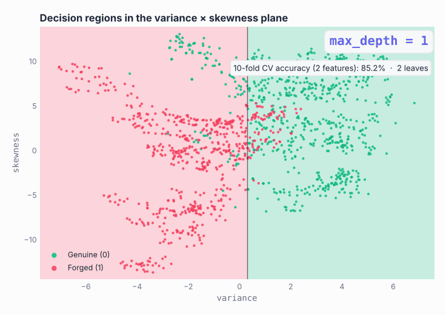
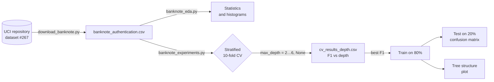
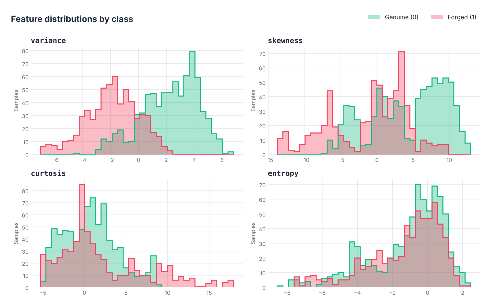
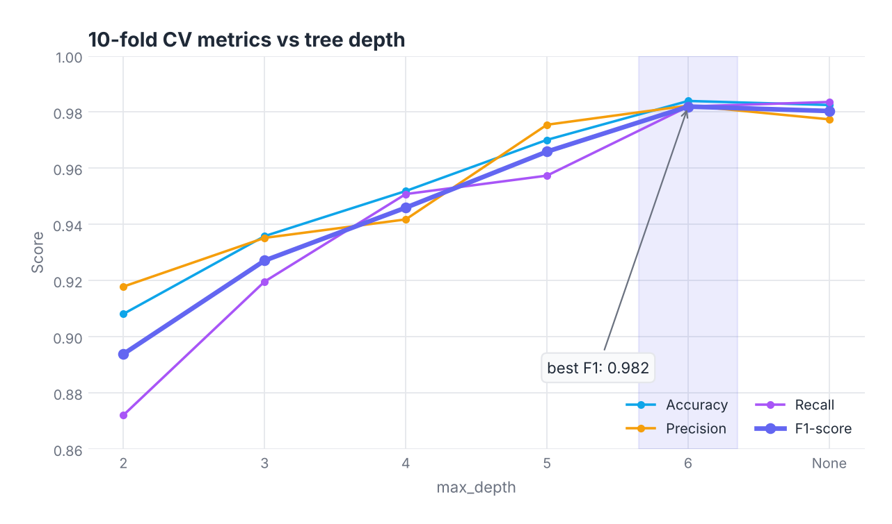
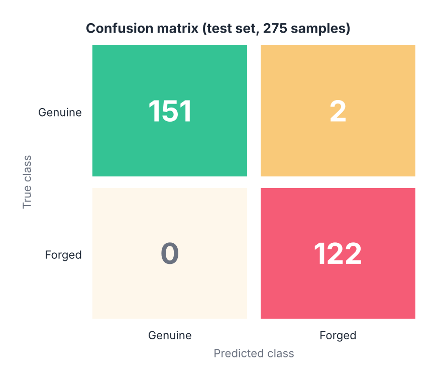
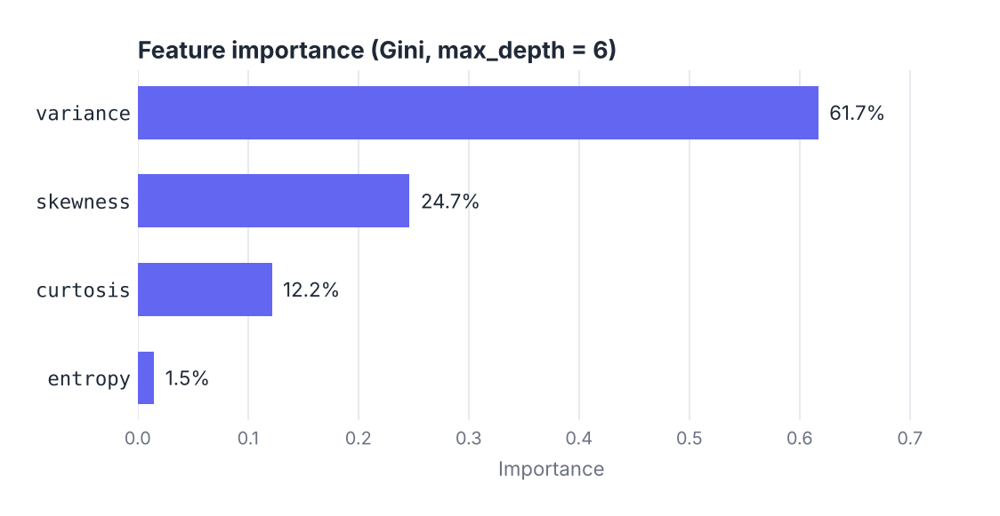
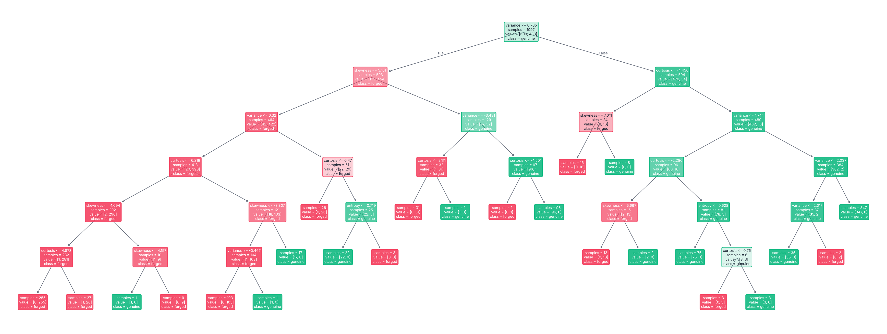

<p align="right">
  <a href="README.md"> <b>English</b></a>
  &nbsp;|&nbsp;
  <a href="README.pl.md"> Polski</a>
</p>

<a href="#see-it-in-action">
  <picture>
    <source media="(prefers-color-scheme: dark)" srcset="docs/banner-en-dark.svg" />
    <source media="(prefers-color-scheme: light)" srcset="docs/banner-en-light.svg" />
    
  </picture>
</a>

<p align="center">
  
  
  
  
  
  
</p>

<p align="center">
  <a href="#see-it-in-action"><b>Demo</b></a> &nbsp;·&nbsp;
  <a href="#highlights"><b>Highlights</b></a> &nbsp;·&nbsp;
  <a href="#the-dataset"><b>Dataset</b></a> &nbsp;·&nbsp;
  <a href="#exploratory-data-analysis"><b>EDA</b></a> &nbsp;·&nbsp;
  <a href="#experiments"><b>Experiments</b></a> &nbsp;·&nbsp;
  <a href="#getting-started"><b>Getting started</b></a>
</p>

**Banknote Authentication** is a classification project for the *Data Warehousing and Data Mining* course (*Hurtownie i Eksploracja Danych*) at Wrocław University of Science and Technology. A **decision tree** from scikit-learn learns to tell **genuine** banknotes (class 0) from **forged** ones (class 1) using four statistics extracted from banknote images with a **wavelet transform**.

The workflow is the classic data mining loop: download the data, explore every feature, tune the tree depth with **stratified 10-fold cross-validation**, then train the best model and check it on a held-out test set. The final tree misclassifies **2 of 275** test banknotes.

## See it in action

<p align="center">
  <picture>
    <source media="(prefers-color-scheme: dark)" srcset="docs/en/boundary-dark.gif" />
    <source media="(prefers-color-scheme: light)" srcset="docs/en/boundary-light.gif" />
    
  </picture>
</p>

<p align="center"><sub>A tree trained on just <code>variance</code> and <code>skewness</code>, grown from <code>max_depth = 1</code> to unlimited. Each split adds an axis-aligned cut. With two features the CV accuracy stalls around 93%, and the unlimited tree starts carving tiny boxes around single points: that is overfitting you can see. The real model uses all four features.</sub></p>

## Highlights

<table>
  <tr>
    <td width="25%" align="center"><h3>1372</h3><sub>banknote images<br/>4 numeric features</sub></td>
    <td width="25%" align="center"><h3>0.982</h3><sub>F1-score<br/>10-fold CV, <code>max_depth = 6</code></sub></td>
    <td width="25%" align="center"><h3>99.3%</h3><sub>accuracy on the test set<br/>273 of 275 correct</sub></td>
    <td width="25%" align="center"><h3>61.7%</h3><sub>of the tree's decisions<br/>driven by <code>variance</code></sub></td>
  </tr>
</table>

- **Reproducible end to end.** Every split uses `random_state = 42`, and each script writes its tables (`*.csv`) and charts (`plots/`) so the numbers in this README can be regenerated with three commands.
- **Depth chosen by data, not by guess.** Six depths (`2` to `6` and unlimited) are compared on accuracy, precision, recall and F1, and the script picks the best F1 automatically.
- **Stratified everywhere.** Both the CV folds and the 80/20 train/test split keep the 55.5% / 44.5% class ratio.
- **Interpretable model.** The whole classifier fits on one picture, and its first split already separates most of the data.

## How it works



## The dataset

Data comes from the [UCI Machine Learning Repository](https://archive.ics.uci.edu/dataset/267/banknote+authentication) (ID 267). Images of genuine and forged banknotes were processed with a wavelet transform, and each image is described by four numbers:

| Feature | Description |
|---|---|
| `variance` | Variance of the wavelet-transformed image |
| `skewness` | Skewness of the wavelet-transformed image |
| `curtosis` | Kurtosis of the wavelet-transformed image |
| `entropy` | Entropy of the image |

### Class distribution

| Class | Meaning | Samples | Share |
|---|---|---|---|
| 0 | Genuine banknote | 762 | 55.5% |
| 1 | Forged banknote | 610 | 44.5% |

The classes are close to balanced, so plain accuracy is meaningful, but F1 is still used for model selection.

### Descriptive statistics

| | variance | skewness | curtosis | entropy |
|---|---|---|---|---|
| Mean | 0.434 | 1.922 | 1.398 | −1.192 |
| Std. dev. | 2.843 | 5.869 | 4.310 | 2.101 |
| Min | −7.042 | −13.773 | −5.286 | −8.548 |
| Median | 0.496 | 2.320 | 0.617 | −0.587 |
| Max | 6.825 | 12.952 | 17.927 | 2.450 |

## Exploratory data analysis

<p align="center">
  <picture>
    <source media="(prefers-color-scheme: dark)" srcset="docs/en/features-dark.png" />
    <source media="(prefers-color-scheme: light)" srcset="docs/en/features-light.png" />
    
  </picture>
</p>

| Feature | What the histograms show |
|---|---|
| `variance` | The strongest separator. Genuine notes sit mostly above 0, forged ones below, with only a narrow overlap around 0 to 2. |
| `skewness` | Multimodal. Genuine notes dominate the 5 to 10 range, forgeries cluster at negative values and near zero. |
| `curtosis` | Right-skewed with a long tail. The classes overlap heavily between −5 and 5, but values above 10 are almost always forgeries. |
| `entropy` | Concentrated around 0 for both classes. The weakest feature on its own. |

<details>
<summary><b>Original histograms</b> generated by <code>banknote_eda.py</code></summary>
<br/>

| Feature | All samples | By class |
|---|---|---|
| `variance` |  |  |
| `skewness` |  |  |
| `curtosis` |  |  |
| `entropy` |  |  |

</details>

## Experiments

### Choosing the depth with 10-fold cross-validation

`max_depth` controls how many questions the tree may ask before it answers. Too shallow and it underfits, unlimited and it memorises noise. Each depth was scored with **stratified 10-fold CV** (`shuffle = True`, `random_state = 42`), averaging the metrics over the folds.

| max_depth | Accuracy | Precision | Recall | F1-score |
|---|---|---|---|---|
| 2 | 0.908 | 0.918 | 0.872 | 0.894 |
| 3 | 0.936 | 0.935 | 0.920 | 0.927 |
| 4 | 0.952 | 0.942 | 0.951 | 0.946 |
| 5 | 0.970 | 0.975 | 0.957 | 0.966 |
| **6** | **0.984** | **0.982** | **0.982** | **0.982** |
| None | 0.983 | 0.977 | 0.984 | 0.980 |

<p align="center">
  <picture>
    <source media="(prefers-color-scheme: dark)" srcset="docs/en/cv-depth-dark.png" />
    <source media="(prefers-color-scheme: light)" srcset="docs/en/cv-depth-light.png" />
    
  </picture>
</p>

The best F1 is reached at **`max_depth = 6`**. Removing the limit (`None`) lowers precision and F1 slightly, a mild sign of overfitting, so depth 6 is the model that goes forward.

### Evaluation on the test set

The depth-6 tree was trained on 80% of the data (1097 samples) and evaluated on the remaining 20% (275 samples), both stratified.

<table>
  <tr>
    <td width="50%" align="center">
      <picture>
        <source media="(prefers-color-scheme: dark)" srcset="docs/en/confusion-dark.png" />
        <source media="(prefers-color-scheme: light)" srcset="docs/en/confusion-light.png" />
        
      </picture>
    </td>
    <td width="50%">

| Metric | Genuine (0) | Forged (1) |
|---|---|---|
| Precision | 1.000 | 0.984 |
| Recall | 0.987 | 1.000 |
| Support | 153 | 122 |

**Accuracy: 99.3%** (273 / 275)

Both errors are genuine banknotes flagged as forged. **No forgery slipped through**, which is the cheaper kind of mistake for this task.

</td>
  </tr>
</table>

### What the tree relies on

<p align="center">
  <picture>
    <source media="(prefers-color-scheme: dark)" srcset="docs/en/importance-dark.png" />
    <source media="(prefers-color-scheme: light)" srcset="docs/en/importance-light.png" />
    
  </picture>
</p>

Gini importance confirms the EDA: `variance` carries most of the decision, `skewness` and `curtosis` refine the overlapping cases, and `entropy` is used for only two small splits.

### Tree structure

<p align="center">
  <a href="docs/en/tree-light.png">
    <picture>
      <source media="(prefers-color-scheme: dark)" srcset="docs/en/tree-dark.png" />
      <source media="(prefers-color-scheme: light)" srcset="docs/en/tree-light.png" />
      
    </picture>
  </a>
</p>

<p align="center"><sub>Green nodes lean genuine, red nodes lean forged, and stronger colour means a purer node. Click to enlarge.</sub></p>

The root splits on **`variance ≤ 0.765`**: below that, 77% of the training samples are forgeries, above it 93% are genuine. The tree has **24 leaves** and most of them are pure.

## Getting started

<p align="center">
  
</p>

```bash
pip install pandas scikit-learn matplotlib ucimlrepo

# 1. Download the data (optional, the CSV is already in the repo)
python download_banknote.py

# 2. Exploratory analysis: statistics, class counts, histograms
python banknote_eda.py

# 3. Cross-validation, final model, confusion matrix and tree plot
python banknote_experiments.py
```

Scripts print their results in Polish and save everything next to themselves: CSV tables in the project root and charts in `plots/`.

### Requirements

- Python 3.10+
- pandas, scikit-learn, matplotlib
- ucimlrepo (only for downloading the data)

## Project structure

```
.
├── README.md                    # English README
├── README.pl.md                 # Polish README
├── banknote_authentication.csv  # Dataset (1372 rows)
├── download_banknote.py         # Fetches the data from UCI
├── banknote_eda.py              # Exploratory data analysis
├── banknote_experiments.py      # Cross-validation and final model
├── banknote_summary_stats.csv   # Descriptive statistics
├── banknote_class_counts.csv    # Class distribution
├── cv_results_depth.csv         # CV results for each max_depth
├── plots/                       # Charts written by the scripts
└── docs/                        # README visuals (EN / PL, light / dark)
```

---

<p align="center">
  <sub>Wrocław University of Science and Technology · Data Warehousing and Data Mining · Grzegorz Sienkiewicz</sub>
</p>
