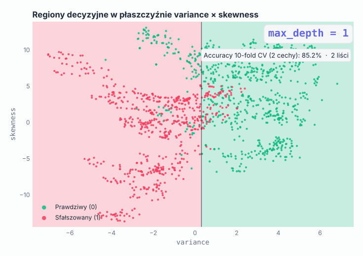
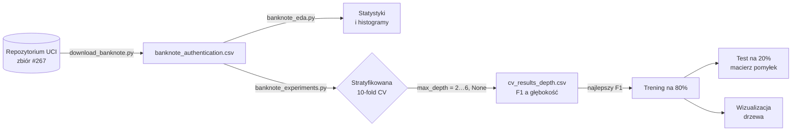
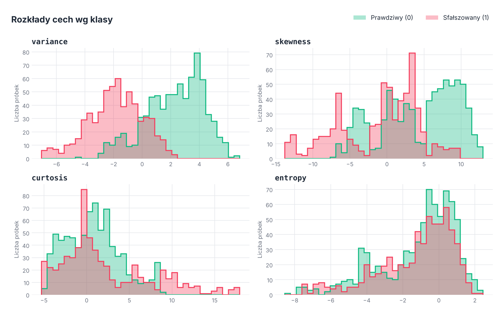
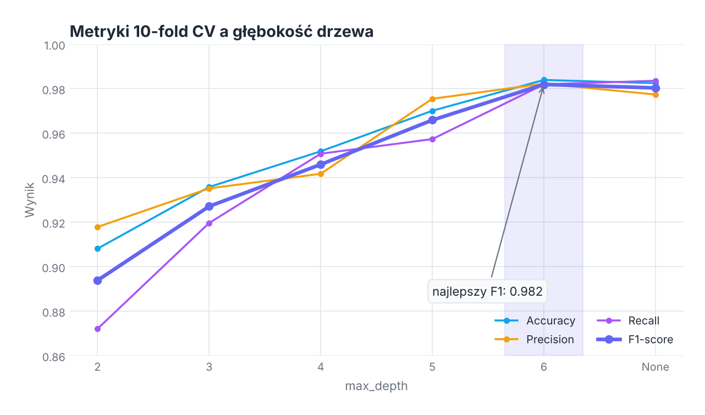
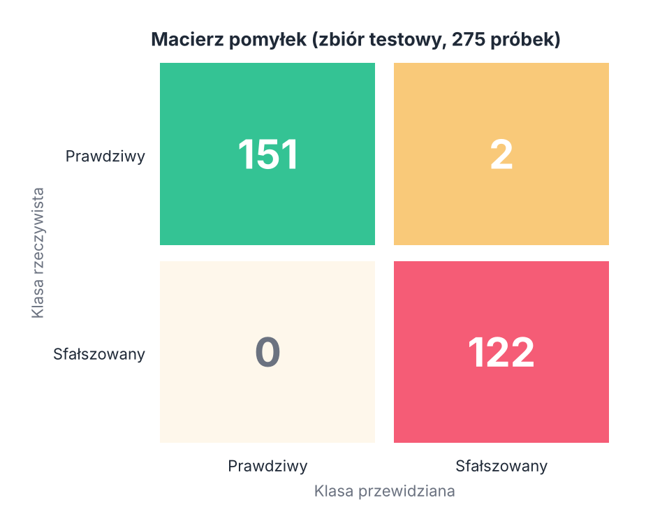
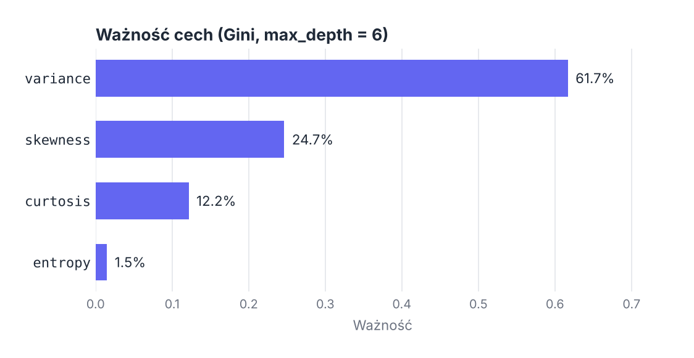
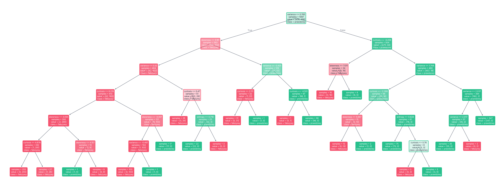

<p align="right">
  <a href="README.md"> English</a>
  &nbsp;|&nbsp;
  <a href="README.pl.md"> <b>Polski</b></a>
</p>

<a href="#zobacz-w-akcji">
  <picture>
    <source media="(prefers-color-scheme: dark)" srcset="docs/banner-pl-dark.svg" />
    <source media="(prefers-color-scheme: light)" srcset="docs/banner-pl-light.svg" />
    
  </picture>
</a>

<p align="center">
  
  
  
  
  
  
</p>

<p align="center">
  <a href="#zobacz-w-akcji"><b>Demo</b></a> &nbsp;·&nbsp;
  <a href="#kluczowe-wyniki"><b>Wyniki</b></a> &nbsp;·&nbsp;
  <a href="#zbiór-danych"><b>Zbiór danych</b></a> &nbsp;·&nbsp;
  <a href="#eksploracyjna-analiza-danych-eda"><b>EDA</b></a> &nbsp;·&nbsp;
  <a href="#eksperymenty"><b>Eksperymenty</b></a> &nbsp;·&nbsp;
  <a href="#uruchomienie"><b>Uruchomienie</b></a>
</p>

**Autentykacja banknotów** to projekt klasyfikacyjny z przedmiotu *Hurtownie i Eksploracja Danych* na Politechnice Wrocławskiej. **Drzewo decyzyjne** ze scikit-learn uczy się odróżniać banknoty **prawdziwe** (klasa 0) od **sfałszowanych** (klasa 1) na podstawie czterech statystyk wyznaczonych z obrazów banknotów za pomocą **transformaty falkowej**.

Przebieg pracy to klasyczna pętla eksploracji danych: pobranie danych, analiza każdej cechy, dobór głębokości drzewa **stratyfikowaną 10-krotną walidacją krzyżową**, a na końcu trening najlepszego modelu i sprawdzenie go na odłożonym zbiorze testowym. Końcowe drzewo myli się w **2 z 275** banknotów testowych.

## Zobacz w akcji

<p align="center">
  <picture>
    <source media="(prefers-color-scheme: dark)" srcset="docs/pl/boundary-dark.gif" />
    <source media="(prefers-color-scheme: light)" srcset="docs/pl/boundary-light.gif" />
    
  </picture>
</p>

<p align="center"><sub>Drzewo uczone tylko na <code>variance</code> i <code>skewness</code>, rosnące od <code>max_depth = 1</code> do braku limitu. Każdy podział dokłada jedno cięcie równoległe do osi. Przy dwóch cechach accuracy w CV zatrzymuje się w okolicy 93%, a drzewo bez limitu zaczyna wycinać małe prostokąty wokół pojedynczych punktów: tak wygląda przeuczenie. Właściwy model korzysta ze wszystkich czterech cech.</sub></p>

## Kluczowe wyniki

<table>
  <tr>
    <td width="25%" align="center"><h3>1372</h3><sub>obrazy banknotów<br/>4 cechy numeryczne</sub></td>
    <td width="25%" align="center"><h3>0,982</h3><sub>F1-score<br/>10-fold CV, <code>max_depth = 6</code></sub></td>
    <td width="25%" align="center"><h3>99,3%</h3><sub>accuracy na zbiorze testowym<br/>273 z 275 poprawnie</sub></td>
    <td width="25%" align="center"><h3>61,7%</h3><sub>decyzji drzewa<br/>opiera się na <code>variance</code></sub></td>
  </tr>
</table>

- **Pełna powtarzalność.** Każdy podział używa `random_state = 42`, a skrypty zapisują tabele (`*.csv`) i wykresy (`plots/`), więc liczby z tego README da się odtworzyć trzema komendami.
- **Głębokość wybrana na danych, nie na oko.** Porównano sześć głębokości (od `2` do `6` oraz bez limitu) pod względem accuracy, precision, recall i F1, a skrypt sam wybiera najlepszy F1.
- **Stratyfikacja wszędzie.** Zarówno foldy CV, jak i podział trening/test 80/20 zachowują proporcję klas 55,5% / 44,5%.
- **Model interpretowalny.** Cały klasyfikator mieści się na jednym rysunku, a już pierwszy podział rozdziela większość danych.

## Jak to działa



## Zbiór danych

Dane pochodzą z [UCI Machine Learning Repository](https://archive.ics.uci.edu/dataset/267/banknote+authentication) (ID 267). Obrazy prawdziwych i sfałszowanych banknotów przetworzono transformatą falkową, a każdy obraz opisują cztery liczby:

| Cecha | Opis |
|---|---|
| `variance` | Wariancja obrazu po transformacie falkowej |
| `skewness` | Skośność obrazu po transformacie falkowej |
| `curtosis` | Kurtoza obrazu po transformacie falkowej |
| `entropy` | Entropia obrazu |

### Rozkład klas

| Klasa | Znaczenie | Liczba próbek | Udział |
|---|---|---|---|
| 0 | Banknot prawdziwy | 762 | 55,5% |
| 1 | Banknot sfałszowany | 610 | 44,5% |

Klasy są prawie zbalansowane, więc samo accuracy ma sens, ale do wyboru modelu i tak użyto F1.

### Statystyki opisowe

| | variance | skewness | curtosis | entropy |
|---|---|---|---|---|
| Średnia | 0,434 | 1,922 | 1,398 | −1,192 |
| Odch. std. | 2,843 | 5,869 | 4,310 | 2,101 |
| Min | −7,042 | −13,773 | −5,286 | −8,548 |
| Mediana | 0,496 | 2,320 | 0,617 | −0,587 |
| Max | 6,825 | 12,952 | 17,927 | 2,450 |

## Eksploracyjna analiza danych (EDA)

<p align="center">
  <picture>
    <source media="(prefers-color-scheme: dark)" srcset="docs/pl/features-dark.png" />
    <source media="(prefers-color-scheme: light)" srcset="docs/pl/features-light.png" />
    
  </picture>
</p>

| Cecha | Co widać na histogramach |
|---|---|
| `variance` | Najsilniej rozdziela klasy. Prawdziwe banknoty leżą głównie powyżej 0, fałszywki poniżej, a nakładają się tylko w wąskim pasie od 0 do 2. |
| `skewness` | Rozkład wielomodalny. Prawdziwe banknoty dominują w przedziale od 5 do 10, fałszywki skupiają się przy wartościach ujemnych i bliskich zeru. |
| `curtosis` | Prawoskośna z długim ogonem. Klasy mocno nakładają się między −5 a 5, ale wartości powyżej 10 to prawie zawsze fałszywki. |
| `entropy` | Skupiona wokół 0 w obu klasach. Sama w sobie najsłabsza cecha. |

<details>
<summary><b>Oryginalne histogramy</b> z <code>banknote_eda.py</code></summary>
<br/>

| Cecha | Wszystkie próbki | Wg klasy |
|---|---|---|
| `variance` |  |  |
| `skewness` |  |  |
| `curtosis` |  |  |
| `entropy` |  |  |

</details>

## Eksperymenty

### Dobór głębokości walidacją krzyżową (10-fold)

`max_depth` określa, ile pytań drzewo może zadać, zanim odpowie. Zbyt płytkie drzewo jest niedouczone, a bez limitu zaczyna zapamiętywać szum. Każdą głębokość oceniono **stratyfikowaną 10-krotną walidacją krzyżową** (`shuffle = True`, `random_state = 42`), uśredniając metryki po foldach.

| max_depth | Accuracy | Precision | Recall | F1-score |
|---|---|---|---|---|
| 2 | 0,908 | 0,918 | 0,872 | 0,894 |
| 3 | 0,936 | 0,935 | 0,920 | 0,927 |
| 4 | 0,952 | 0,942 | 0,951 | 0,946 |
| 5 | 0,970 | 0,975 | 0,957 | 0,966 |
| **6** | **0,984** | **0,982** | **0,982** | **0,982** |
| None | 0,983 | 0,977 | 0,984 | 0,980 |

<p align="center">
  <picture>
    <source media="(prefers-color-scheme: dark)" srcset="docs/pl/cv-depth-dark.png" />
    <source media="(prefers-color-scheme: light)" srcset="docs/pl/cv-depth-light.png" />
    
  </picture>
</p>

Najwyższy F1 uzyskano dla **`max_depth = 6`**. Zdjęcie limitu (`None`) nieznacznie obniża precision i F1, co wskazuje na lekkie przeuczenie, więc dalej idzie drzewo o głębokości 6.

### Ewaluacja na zbiorze testowym

Drzewo o głębokości 6 wytrenowano na 80% danych (1097 próbek) i sprawdzono na pozostałych 20% (275 próbek), w obu przypadkach ze stratyfikacją.

<table>
  <tr>
    <td width="50%" align="center">
      <picture>
        <source media="(prefers-color-scheme: dark)" srcset="docs/pl/confusion-dark.png" />
        <source media="(prefers-color-scheme: light)" srcset="docs/pl/confusion-light.png" />
        
      </picture>
    </td>
    <td width="50%">

| Metryka | Prawdziwy (0) | Sfałszowany (1) |
|---|---|---|
| Precision | 1,000 | 0,984 |
| Recall | 0,987 | 1,000 |
| Liczba próbek | 153 | 122 |

**Accuracy: 99,3%** (273 / 275)

Oba błędy to prawdziwe banknoty uznane za fałszywe. **Żadna fałszywka nie przeszła**, a w tym zadaniu to tańszy rodzaj pomyłki.

</td>
  </tr>
</table>

### Na czym opiera się drzewo

<p align="center">
  <picture>
    <source media="(prefers-color-scheme: dark)" srcset="docs/pl/importance-dark.png" />
    <source media="(prefers-color-scheme: light)" srcset="docs/pl/importance-light.png" />
    
  </picture>
</p>

Ważność Gini potwierdza wnioski z EDA: `variance` niesie większość decyzji, `skewness` i `curtosis` dopracowują przypadki z obszaru nakładania się klas, a `entropy` pojawia się tylko w dwóch drobnych podziałach.

### Struktura drzewa decyzyjnego

<p align="center">
  <a href="docs/pl/tree-light.png">
    <picture>
      <source media="(prefers-color-scheme: dark)" srcset="docs/pl/tree-dark.png" />
      <source media="(prefers-color-scheme: light)" srcset="docs/pl/tree-light.png" />
      
    </picture>
  </a>
</p>

<p align="center"><sub>Zielone węzły skłaniają się ku banknotom prawdziwym, czerwone ku fałszywkom, a mocniejszy kolor oznacza czystszy węzeł. Kliknij, aby powiększyć.</sub></p>

Korzeń dzieli próbki po **`variance ≤ 0.765`**: poniżej progu 77% próbek treningowych to fałszywki, powyżej 93% to banknoty prawdziwe. Drzewo ma **24 liście**, z których większość jest czysta.

## Uruchomienie

<p align="center">
  
</p>

```bash
pip install pandas scikit-learn matplotlib ucimlrepo

# 1. Pobranie danych (opcjonalne, CSV jest już w repozytorium)
python download_banknote.py

# 2. Analiza eksploracyjna: statystyki, liczność klas, histogramy
python banknote_eda.py

# 3. Walidacja krzyżowa, model końcowy, macierz pomyłek i wizualizacja drzewa
python banknote_experiments.py
```

Skrypty zapisują wyniki obok siebie: tabele CSV w katalogu głównym projektu, a wykresy w `plots/`.

### Wymagania

- Python 3.10+
- pandas, scikit-learn, matplotlib
- ucimlrepo (tylko do pobrania danych)

## Struktura projektu

```
.
├── README.md                    # README po angielsku
├── README.pl.md                 # README po polsku
├── banknote_authentication.csv  # Zbiór danych (1372 wiersze)
├── download_banknote.py         # Pobieranie danych z UCI
├── banknote_eda.py              # Eksploracyjna analiza danych
├── banknote_experiments.py      # Walidacja krzyżowa i model końcowy
├── banknote_summary_stats.csv   # Statystyki opisowe
├── banknote_class_counts.csv    # Rozkład klas
├── cv_results_depth.csv         # Wyniki CV dla każdego max_depth
├── plots/                       # Wykresy zapisywane przez skrypty
└── docs/                        # Grafiki do README (EN / PL, jasne / ciemne)
```

---

<p align="center">
  <sub>Politechnika Wrocławska · Hurtownie i Eksploracja Danych · Grzegorz Sienkiewicz</sub>
</p>
